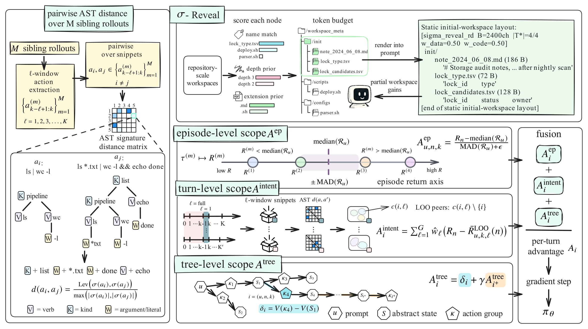

# Learning CLI Agents with Structured Action Credit under Selective Observation

<p align="center">
  <a href="https://hoyant-su.github.io/agentic-rl-a3-project/"></a>
  <a href="https://arxiv.org/abs/2605.08013"></a>
  <a href="https://github.com/Hoyant-Su/Agentic-RL-A3"></a>
  <a href="https://huggingface.co/datasets/Hoyant-Su/ShellOps"></a>
  <a href="https://huggingface.co/Hoyant-Su/A3-Qwen3-14B"></a>
</p>

## What's new

**[October 2026]** We release the [A3-trained Qwen3-14B weights](https://huggingface.co/Hoyant-Su/A3-Qwen3-14B) and an [end-to-end ShellOps demo](#demo), with a recorded walkthrough and instructions for running both the vanilla and $\sigma$-Reveal harnesses.

**[September 2026]** Our [project homepage](https://hoyant-su.github.io/agentic-rl-a3-project/) is now live on GitHub Pages.

**[September 2026]** 🎉 Our paper **Learning CLI Agents with Structured Action Credit under Selective Observation** has been accepted to **NeurIPS 2026**!

**[May 2026]** Code for **Learning CLI Agents with Structured Action Credit under Selective Observation** is released on [GitHub](https://github.com/Hoyant-Su/Agentic-RL-A3). Companion datasets are available through the [ShellOps Hugging Face page](https://huggingface.co/datasets/Hoyant-Su/ShellOps).

## Proposed Method

**A<sup>3</sup> (Action Advantage Assignment)**

- Native CLI-agent attributes for agentic RL
- Structured CLI code credit for policy optimization
- Episode, turn, and trajectory-tree advantages from executable shell actions

<p align="center">
  
</p>

---

## Quick Start

Create the conda environment and install the sandbox-side CLI dependencies:

```bash
conda env create -f environ/environment.yml
conda activate cli_agent
bash main_entry/pre_build/install_apt.sh
```

`install_apt.sh` prepares the apt libraries required by CLI-agent execution in sandbox. The research implementation is docker-free.

---

## Data

Place benchmark data under `main_entry/data/<bench_name>/`. `shellops_pro` is an OOD infer-only dataset. All other benchmark directories should contain `train.parquet`, `test.parquet`, and the correlated task assets folder.

```bash
mkdir -p main_entry/data
tar -xzvf /path/to/data_a3.tar.gz -C main_entry/data
```

`shellops` and `shellops_pro` are the task-specific datasets introduced in this work and are released on [A3_huggingface_page](https://huggingface.co/datasets/Hoyant-Su/ShellOps). The remaining benchmark splits are derived from existing open-source datasets. Due to upstream license constraints, please contact the authors for access to the reconstructed data. Issues and questions are welcome in [A3_issues_link](https://github.com/Hoyant-Su/Agentic-RL-A3/issues).

Supported benchmark keys include `agentbench_os`, `databench`, `shellops`, `ehrcon_curated`, `agentbench_dbbench`, `tablebench`, and `shellops_pro`.

---

## Training

Configure the A3 run in `main_entry/cli_agent_bash_coding/train/A3_algo/config.yaml`. The main fields to set are the benchmark list, base model path, batch sizes, and A3 hyperparameters. For mixed-benchmark training:

```yaml
settings:
  bench: ["agentbench_os", "databench", "shellops", "ehrcon_curated", "agentbench_dbbench", "tablebench"]
```

Launch training with:

```bash
cd main_entry/cli_agent_bash_coding/train/A3_algo
bash launch_bash_coding.sh
```

Checkpoints are written to `main_entry/cli_agent_bash_coding/checkpoints/`, and run metadata/results are written under `main_entry/cli_agent_bash_coding/results/`.

---

## Inference

Inference with a trained model uses the same A3 entrypoint as training. In `main_entry/cli_agent_bash_coding/train/A3_algo/config.yaml`, fill `model.checkpoint_pair` with the trained checkpoint and the base model path:

```yaml
model:
  checkpoint_pair: "<trained_checkpoint>:<pretrained_model_path_default>"
  pretrained_model_path_default: "Qwen/Qwen3-14B"
```

Once `checkpoint_pair` is set, the launcher enters TEST MODE automatically. Use `vanilla` for the standard harness and `sigma_reveal_rd` for $\sigma$-Reveal.

Then run:

```bash
cd main_entry/cli_agent_bash_coding/train/A3_algo
bash launch_bash_coding.sh
```

---

## Demo

Run the released [A3-Qwen3-14B](https://huggingface.co/Hoyant-Su/A3-Qwen3-14B) policy on two ShellOps tasks with **seed 42**. The demo supports both the **vanilla** and **$\sigma$-Reveal** harnesses, using the same model weights and a six-turn budget.

https://github.com/user-attachments/assets/a69f9e62-55b8-45c3-9720-0cdb2ace67d7

Recorded walkthrough (2 min 26 sec). The recording follows each task from its initial workspace through the agent's commands, execution outputs, and file changes to task completion. Playback is paced for readability and does not represent inference latency. For interactive playback, open `demo/replay.html` locally in a browser.

After completing [Quick Start](#quick-start), run the following from the repository root on Linux with a CUDA GPU:

```bash
python -m pip install -r demo/requirements.txt
hf download Hoyant-Su/A3-Qwen3-14B --local-dir outputs/models/A3-Qwen3-14B
bash demo/run.sh --model outputs/models/A3-Qwen3-14B --harness both
```

The runner downloads the selected ShellOps task assets automatically and writes the trajectories and results to `outputs/demo/`. To run one harness, replace `--harness both` with `--harness vanilla` or `--harness sigma_reveal_rd`. When repeating a run, choose a fresh output directory with `--output-dir`.

The recorded runs were validated on an NVIDIA H100 80 GB GPU with BF16 weights and greedy decoding. Both tasks produce the requested files correctly in both harnesses; these examples illustrate agent behavior and are not a reproduction of the full benchmark evaluation. See [demo/config.yaml](demo/config.yaml) for the exact settings and [demo/example_outputs](demo/example_outputs) for the saved trajectories.

---

## Evaluation

Inference outputs JSONL trajectories under `main_entry/cli_agent_bash_coding/results/` or the configured output path. Aggregate and score a run with:

```bash
export RESULTS_JSONL="main_entry/cli_agent_bash_coding/results/<run>/<file>.jsonl"
bash main_entry/cli_agent_bash_coding/eval/run_eval_results_jsonl.sh "$RESULTS_JSONL" [optional_parquet_path]
```

Set `EVAL_WORKERS` to control evaluation parallelism.

---

## Acknowledgements

This repository builds on the code infrastructure of `verl` and `verl-agent`. We thank these projects for supporting open research in large-scale reinforcement learning and agentic training.

---

## Citation

```bibtex
@misc{su2026learningcliagentsstructured,
      title={Learning CLI Agents with Structured Action Credit under Selective Observation}, 
      author={Haoyang Su and Ying Wen},
      year={2026},
      eprint={2605.08013},
      archivePrefix={arXiv},
      primaryClass={cs.AI},
      url={https://arxiv.org/abs/2605.08013}, 
}
```
